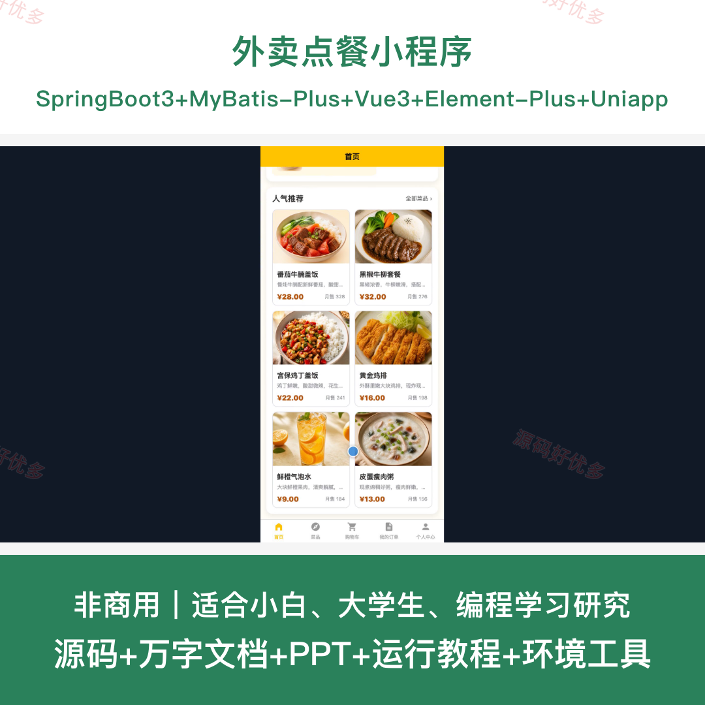
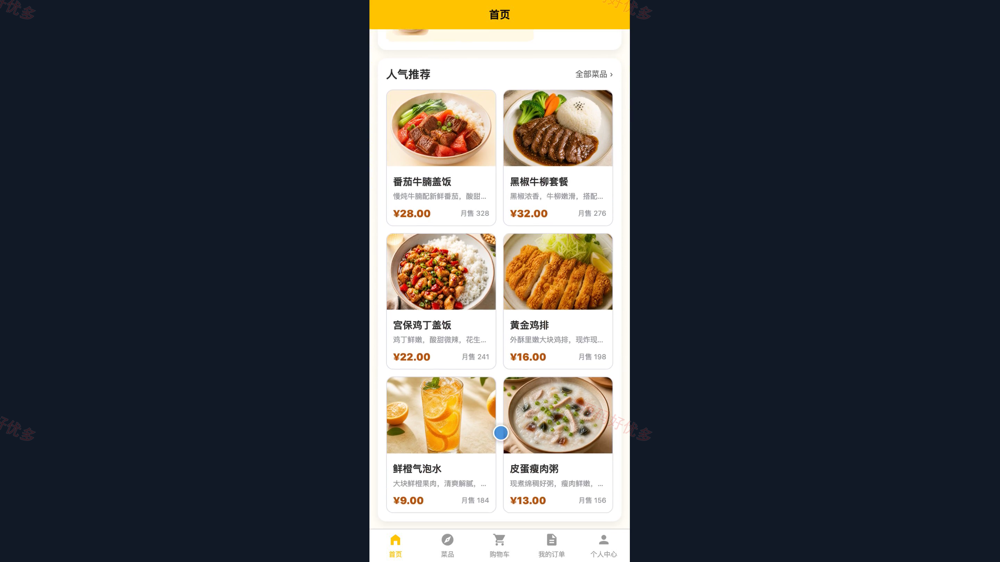
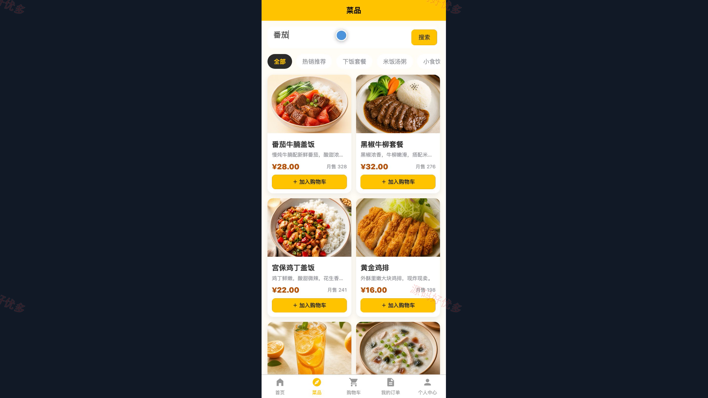
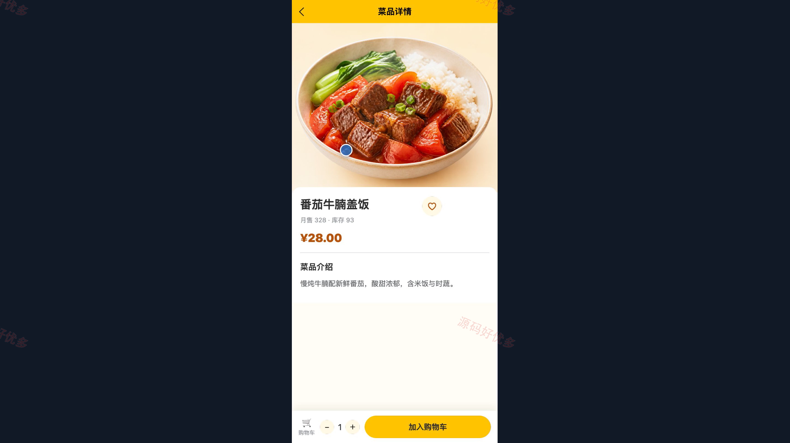
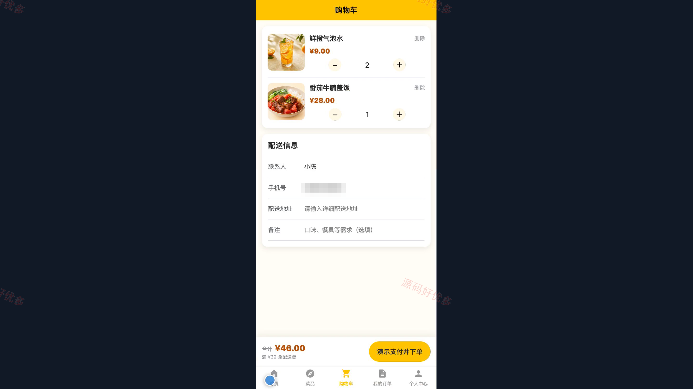
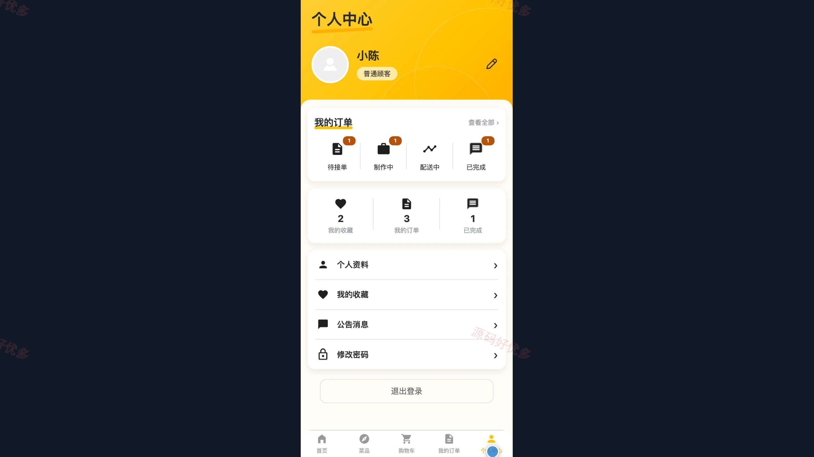
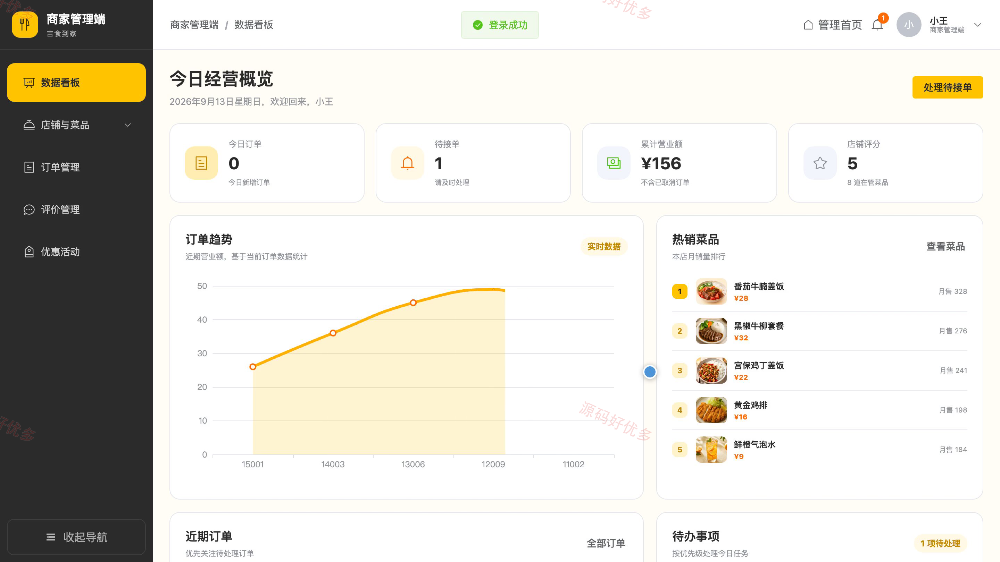
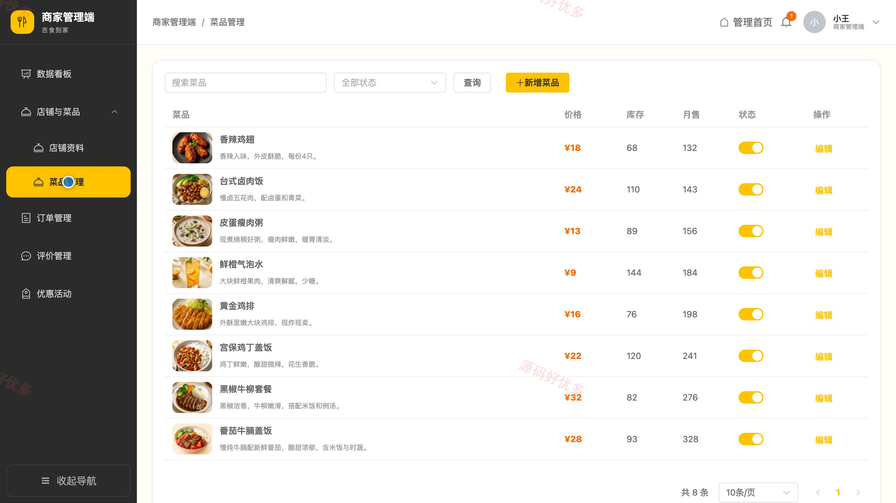
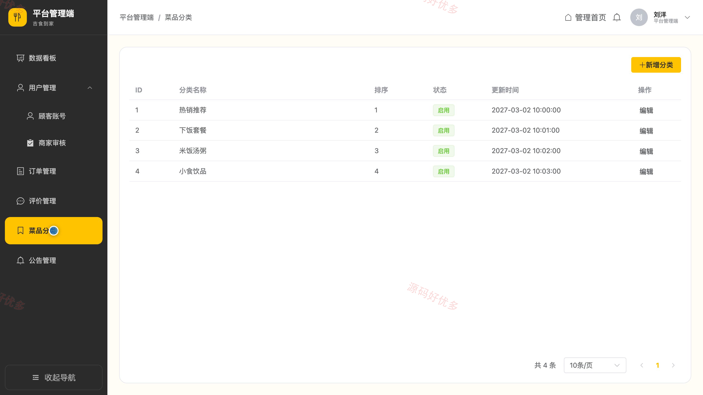

## 源码问题查看主页咨询

### 一、关键词
外卖点餐、在线订餐、餐饮配送、餐厅点单、商家接单

### 二、作品包含
源码+数据库+万字设计文档+PPT+全套环境和工具资源+本地部署教程

### 三、项目技术
前端技术： Html、Css、Js、Vue3.4、Element-Plus、uniapp
后端技术：Java、SpringBoot3.2.0、MyBatis-Plus

### 四、运行环境要求
开发工具：IDEA/eclipse + VSCODE + HBuilder X + 微信开发者工具

数据库：MySQL5.7+（共13张表）

数据库管理工具：Navicat10以上版本

环境配置软件： JDK17 + Maven3.6

前端Nodejs：16+

浏览器：谷歌浏览器

### 五、项目介绍
项目编号：bs035B

系统以顾客微信小程序和商家、管理员电脑管理端协同为核心，覆盖店铺与菜品浏览、购物车结算、订单履约、评价回复、优惠活动、商家审核和平台运营管理等流程。

角色：顾客、商家、管理员

顾客功能：账号登录、店铺与菜品浏览、购物车管理、订单提交与进度追踪、订单评价、菜品收藏、公告查看、个人资料及密码维护。

商家功能：经营数据看板、店铺资料维护、菜品管理、订单处理与状态流转、评价查看及回复、优惠活动管理、个人资料维护。

管理员功能：运营数据看板、顾客账号管理、商家入驻审核、菜品分类管理、全平台订单监管、评价管理、公告发布与维护、个人资料维护。

### 六、运行截图

